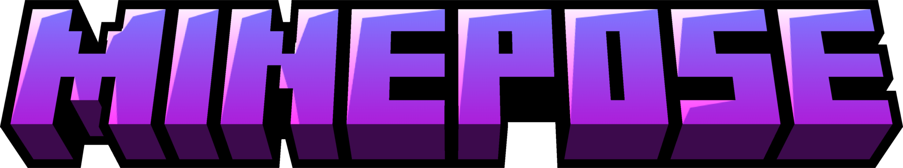

<div align="center">
  
  <p><strong>Твоя личная мастерская для Minecraft-идей</strong></p>
  <p>Создавай позы, аватары, баннеры и анимации — прямо в браузере.</p>
</div>

<div align="center">


</div>

MinePose — русскоязычная творческая мастерская с пиксельным характером и фиолетовыми акцентами. В ней можно собрать сцену с Minecraft-персонажем, настроить позу и предметы, подготовить графику и сохранить результат на своё устройство. Интерфейс адаптируется к небольшим экранам; аккаунт не нужен.

## Возможности

| Инструмент | Что можно сделать |
| --- | --- |
| **Редактор поз** | Настроить части тела, камеру, фон, свет и предметы в обеих руках; сохранить позу или экспортировать PNG. |
| **Готовые позы** | Найти и просмотреть 3D-шаблон, отметить избранное и открыть его в редакторе. |
| **Animation Studio** | Собрать сцену из нескольких персонажей, работать с ключевыми кадрами и временной шкалой, добавить окружение и звук, экспортировать анимацию. |
| **Создатель аватаров** | Подготовить портрет, голову или мини-персонажа из ника либо загруженного скина и скачать PNG. |
| **Мастерская флагов** | Составить баннер из цветов и узоров Minecraft, получить PNG и команду `/give`. |
| **Генератор заголовков** | Настроить текст, пиксельный шрифт, цвет и эффекты, затем скачать изображение с прозрачным или цветным фоном. |
| **Пиксельные круги** | Построить пиксельную схему окружности с подсчётом блоков. |

### Технологии

- Next.js 16, React 19 и TypeScript
- Tailwind CSS 4
- Three.js для 3D-сцен и предпросмотра
- IndexedDB и `localStorage` для локального хранения проектов
- Локально подключённые шрифты с кириллицей и пиксельные гарнитуры

## Запуск

Требуется Node.js 20.9 или новее.

```bash
npm install
npm run dev
```

Открой [http://127.0.0.1:3000](http://127.0.0.1:3000).

Для production-сборки:

```bash
npm run typecheck
npm run build
npm run start
```

## Проверки

В проекте есть браузерные smoke-сценарии для инструментов и основных пользовательских потоков. Сначала запусти dev-сервер, затем нужную проверку:

```bash
npm run test:smoke
npm run test:tools
npm run test:banner
npm run test:animation
```

Для некоторых сценариев нужны установленный Chrome и запущенный сайт. Адрес можно задать переменной `SMOKE_BASE_URL`, путь к Chrome — `SMOKE_CHROME_PATH`. Проверка моделей предметов `npm run test:models` запускает временный сервер самостоятельно.

## Данные и приватность

MinePose работает без учётных записей и публикации пользовательских проектов. Позы хранятся в `localStorage`, а проекты Animation Studio — в IndexedDB браузера. Загруженные изображения кожи обрабатываются на устройстве. Поиск скина по нику использует публичные сервисы Mojang и требует интернет-соединения. Для переноса проектов используй встроенный экспорт и импорт файлов.

Сброс данных сайта в браузере удалит сохранённые локально проекты. Серверной синхронизации между устройствами нет.

## Структура проекта

```text
src/
  app/          страницы и маршруты Next.js
  components/   интерфейс, редакторы и 3D-компоненты
  data/         каталоги и данные инструментов
  lib/          модели, рендеринг и локальное хранилище
public/         логотип, текстуры и модели
scripts/        smoke-проверки и служебные скрипты
```

## Примечание

MinePose — независимый неофициальный проект и не связан с Mojang или Microsoft. Minecraft и связанные материалы принадлежат их правообладателям. Часть игровых текстур включена в проект для отображения предметов и баннеров; сведения об источниках находятся рядом с ресурсами.
